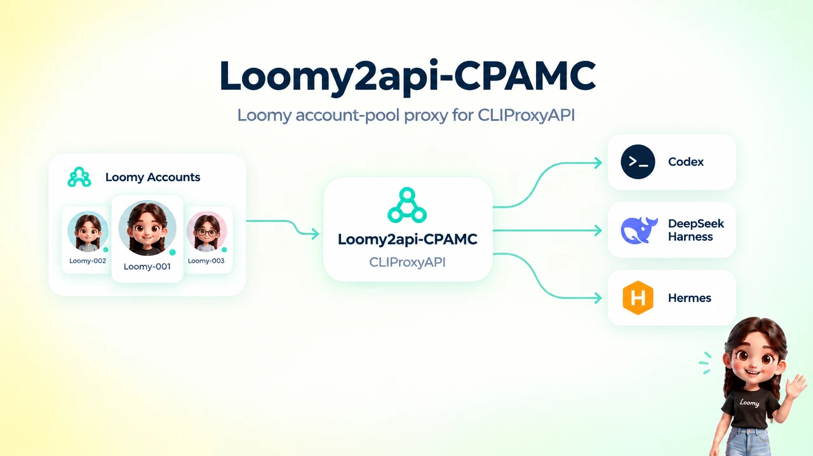
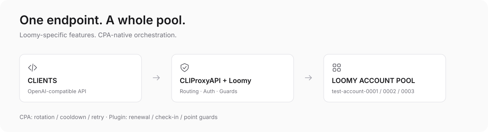

<div align="center">

# Loomy2api-CPAMC

### Use a Loomy account pool through CLIProxyAPI.

A CLIProxyAPI provider plugin that manages Loomy accounts and routes compatible chat requests through the available accounts.

[English](README.md) · [简体中文](README.zh.md) · [Quick start](#quick-start)

</div>

The control panel supports English and Chinese. This project is a CLIProxyAPI plugin, not a standalone proxy or an official Loomy client.

## What it does

- Manages multiple Loomy accounts, sessions, priorities and status.
- Renews password-backed sessions; accounts using manual login can be signed in again by SMS.
- Runs daily check-ins and shows balances, usage, request history and runtime events.
- Applies local account selection and point-use safeguards.
- Includes a bilingual control panel with no external runtime assets or frontend build step.

Upstream rewards, model availability, prices and error responses can change. Local safeguards reduce risk, but they cannot guarantee a spending limit.

## Image input (vision) — clients must declare it

CLIProxyAPI's `/v1/models` returns only `{id, object, owned_by}`. It does **not** publish input modalities, so a client that trusts the model list will treat every `lm/*` model as text-only and refuse to attach images before the request is even sent.

The plugin does track the capability. `GET /v0/management/loomy/models` (management key required) returns `vision` per model, and that is the source of truth:

| `lm/` model | Image input |
|---|---|
| `lm/GLM-5.3-Flash`, `lm/DeepSeek-V4.1-Flash`, `lm/qwen3.8-flash`, `lm/mimo-v2.5` | yes |
| `lm/spark-x2.6`, `lm/deepseek-v4-flash-0731` | no |

Declare it on the client side. For DSH profiles (`cordis.patch.yml`):

```yaml
- id: lm/GLM-5.3-Flash
  name: lm/GLM-5.3-Flash
  contextWindow: 1048576
  input:
    - text
    - image
```

`tools/sync-dsh-models.py` does this automatically from the plugin's own capability map (idempotent, backs up the file first):

```bash
export LOOMY_MGMT_KEY='<plaintext management key>'
python3 tools/sync-dsh-models.py --profile ~/.dsh/profiles/desktop/cordis.patch.yml --dry-run
python3 tools/sync-dsh-models.py --profile ~/.dsh/profiles/desktop/cordis.patch.yml
```

Restart the client afterwards. Without this step a vision model still answers "no image was provided" — the request goes through, the image is dropped on the client side, and nothing errors.

## How it works



| Component | Role |
| :-- | :-- |
| OpenAI-compatible client | Sends requests to CLIProxyAPI's `/v1` endpoint using a model available in the live catalogue |
| CLIProxyAPI | Loads the Go shared-library plugin and handles provider routing and host behavior |
| Loomy2api-CPAMC | Manages Loomy accounts, checks their live catalogues, applies local safeguards and handles supported requests |

The plugin registers chat models available to each enabled account. CLIProxyAPI routes compatible client requests to an eligible Loomy account.

## Quick start

### Build

Use Go 1.26+, gcc and a Linux target matching the CLIProxyAPI host architecture. Building on the target host is simplest; cross-compiling requires a matching CGO toolchain.

```bash
mkdir -p build
(cd plugin && go vet ./... && go test -race ./...)
(cd plugin && CGO_ENABLED=1 go build -buildmode=c-shared \
  -trimpath -ldflags="-s -w" \
  -o "../build/loomy-linux-$(go env GOARCH).so" .)
```

Install the resulting `.so` in your CLIProxyAPI plugin directory, enable the plugin, and restart CLIProxyAPI. Check the host log for `plugin_id=loomy` and the expected version.

Example configuration (adjust paths and values for your installation):

```yaml
plugins:
  enabled: true
  dir: "/path/to/plugins"
  configs:
    loomy:
      enabled: true
      base-url: "http://localhost:8317" # replace with your CLIProxyAPI address
      proxy-url: ""                     # optional http(s):// or socks5:// proxy
      data-dir: ""                      # defaults to ~/.loomy-plugin
      stream-mode: "live"               # live or buffered
      log-retention-days: 30
      default-reasoning-effort: ""   # none|low|medium|high|xhigh; applied when the client sends no reasoning_effort
```

Open **Plugins → Loomy account pool** in the CLIProxyAPI management center, or visit `/v0/resource/plugins/loomy/accounts` on your own instance. Use the management key configured for your instance, then add an account using password or SMS login. Do not use a bcrypt hash as the key.

Configure your OpenAI-compatible client with your own CLIProxyAPI address and client access key (not the management key):

```text
base_url: http://localhost:8317/v1
api_key:  <your client access key>
model:    lm/spark-x2.6
```

The address above is a local example. Use HTTPS or a trusted tunnel when connecting remotely. Model availability and pricing are set by the upstream service and may change.

## Control panel

Choose `English` or `中文` in the language selector; the choice is saved in that browser. The panel also supports system, light and dark themes and responsive layouts. It is embedded in `plugin/panel.html` and has no external runtime assets.

## Point policies and security

| Policy | Behavior |
| :-- | :-- |
| Prefer expiring daily points | Avoids accounts at or below the configured daily floor when another eligible account has daily points |
| Daily-only guard | Blocks paid requests at or below the daily floor instead of intentionally falling back to permanent points |
| Risk circuit breaker | Pauses pool dispatch after risk responses from multiple accounts within the configured window |
| Automatic check-in | Requests the daily allowance after 00:10 Beijing time |
| Automatic renewal | Renews password-backed sessions before expiry, with backoff after failures |

Balances are cached, so point safeguards cannot guarantee a hard spending limit. Unknown balances and concurrent requests can also create risk. Authentication files may contain session data and optional passwords. Restrict access to them (for example, directory mode `0700` and file mode `0600`); never commit real credentials or include them in issues or screenshots. If a credential is exposed, revoke it and remove it from the repository history. New logs redact known credential fields, but no filter can catch every possible secret or clean old logs retroactively.

Use the plugin only with accounts you are authorized to operate, follow the upstream service's terms, and do not resell access.

## Disclaimer

This project is for personal study, technical research and protocol-compatibility work only. It does **not** provide any capability to crack software, bypass payment, take over accounts you do not own, or evade platform risk controls.

- You are responsible for complying with the user agreement, points rules and referral rules published by Loomy and the iFlytek open platform (always the latest version on their official pages).
- The project does **not** encourage or support credit farming, bulk account registration, farming referral rewards, evading risk controls, or renting or reselling access.
- Any account ban, points reset, service interruption, data loss or other consequence of using this project is your own responsibility. The authors accept no liability.
- This project is not affiliated with, authorised by, or endorsed by iFlytek. Loomy and iFlytek are trademarks of their respective owners and are referenced here only to describe compatibility.
- Rights holders who believe this repository infringes their rights may open an issue; we will review and act promptly.

**Use it only with accounts you legitimately own and are entitled to use.** If your jurisdiction or your agreement with the platform forbids this kind of use, stop now.

## Development checks

From `plugin/`, run `go vet ./...` and `go test -race ./...`. The optional `tools/test-panel.cjs` browser test uses mock data only; it requires Node, Playwright and Chromium and does not contact Loomy.

The deployment scripts target Linux hosts using systemd. Review their settings and behavior before using them in your environment. They are examples for this project, not a guarantee that every deployment or rollback will succeed.

[MIT license](LICENSE).
