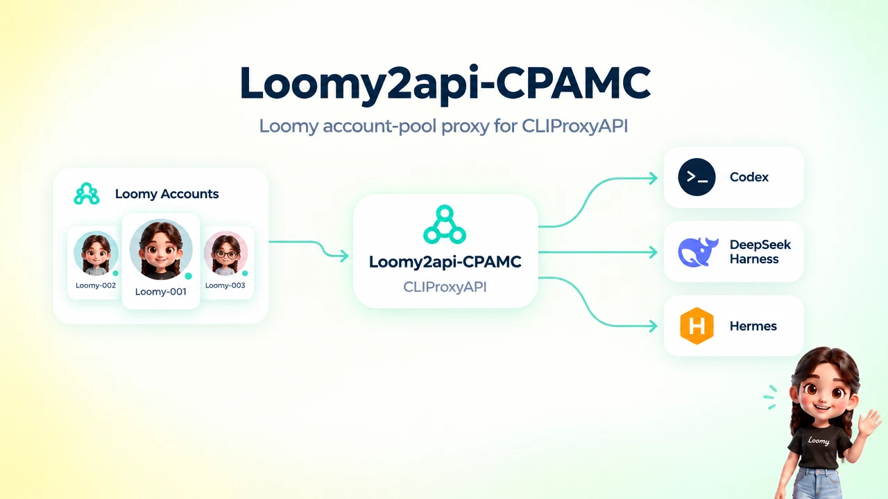
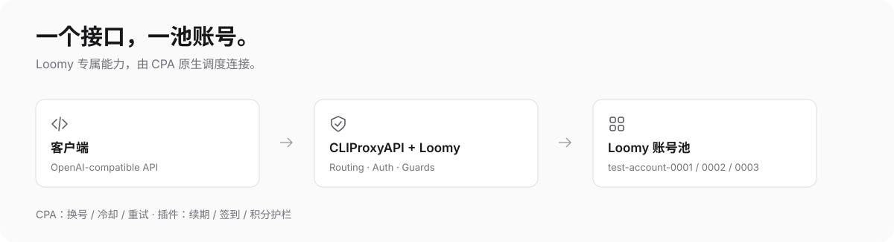

<div align="center">

# Loomy2api-CPAMC

### 通过 CLIProxyAPI 使用 Loomy 账号池。

这是一个 CLIProxyAPI provider 插件，用于管理 Loomy 账号，并通过可用账号处理兼容客户端的对话请求。

[English](README.md) · [简体中文](README.zh.md) · [快速开始](#快速开始)

</div>

控制面板支持中文和 English。本项目是 CLIProxyAPI 插件，不是独立代理，也不是 Loomy 官方客户端。

## 功能

- 管理多个 Loomy 账号、会话、优先级和状态。
- 为保存密码的会话自动续期；手动登录的账号可通过短信重新登录。
- 执行每日签到，并查看余额、用量、请求记录和运行事件。
- 按本地策略选择账号并设置积分使用护栏。
- 内置中英双语控制面板，无需外部运行资源或前端构建步骤。

上游奖励、模型可用性、价格和错误响应可能变化。本地护栏只能降低风险，不能保证固定的消费上限。

## 工作方式



| 组件 | 作用 |
| :-- | :-- |
| OpenAI 兼容客户端 | 使用实时目录中的模型，向 CLIProxyAPI 的 `/v1` 接口发送请求 |
| CLIProxyAPI | 加载 Go 共享库插件并处理 provider 路由及宿主行为 |
| Loomy2api-CPAMC | 管理 Loomy 账号、核对实时目录、应用本地护栏并处理支持的请求 |

插件会登记每个已启用账号当前可用的对话模型。CLIProxyAPI 再将兼容客户端的请求路由到符合条件的 Loomy 账号。

## 快速开始

### 编译

需要 Go 1.26+、gcc，以及与 CLIProxyAPI 主机 CPU 架构匹配的 Linux 目标。在目标主机上编译最简单；跨架构编译需要匹配的 CGO 工具链。

```bash
mkdir -p build
(cd plugin && go vet ./... && go test -race ./...)
(cd plugin && CGO_ENABLED=1 go build -buildmode=c-shared \
  -trimpath -ldflags="-s -w" \
  -o "../build/loomy-linux-$(go env GOARCH).so" .)
```

将生成的 `.so` 放入 CLIProxyAPI 的插件目录，启用插件并重启 CLIProxyAPI。检查宿主日志中是否出现 `plugin_id=loomy` 和预期版本。

配置示例（请按自己的环境调整路径和参数）：

```yaml
plugins:
  enabled: true
  dir: "/path/to/plugins"
  configs:
    loomy:
      enabled: true
      base-url: "http://localhost:8317" # 替换为自己的 CLIProxyAPI 地址
      proxy-url: ""                     # 可选 http(s):// 或 socks5:// 代理
      data-dir: ""                      # 默认 ~/.loomy-plugin
      stream-mode: "live"               # live 真流式或 buffered 缓冲模式
      log-retention-days: 30
```

在 CLIProxyAPI 管理中心打开 **插件 → Loomy 账号池**，或访问自己实例上的 `/v0/resource/plugins/loomy/accounts`。使用自己实例配置的管理密钥，再通过密码或短信登录添加账号。不要把 bcrypt 哈希当作密钥。

OpenAI 兼容客户端请填写自己的 CLIProxyAPI 地址和客户端访问密钥（不是管理密钥）：

```text
base_url: http://localhost:8317/v1
api_key:  <你的客户端访问密钥>
model:    lm/spark-x2.6
```

上面的地址仅是本地示例。远程访问请使用 HTTPS 或可信隧道。模型可用性和价格由上游服务决定，可能变化。

## 控制面板

在语言选择器中选择 `中文` 或 `English`；当前选择会保存在该浏览器。面板支持跟随系统、浅色和深色主题，也适配窄屏。控制面板内嵌于 `plugin/panel.html`，不依赖外部运行资源。

## 积分策略与安全

| 策略 | 行为 |
| :-- | :-- |
| 优先使用快到期的每日额度 | 当其他可用账号的每日余额高于底线时，避免使用余额已到或低于底线的账号 |
| 只用每日额度 | 每日余额到达底线时拦截付费请求，不主动回退到永久积分 |
| 风险熔断 | 多个账号在设定时间窗内出现风险响应时，暂停账号池派发 |
| 自动签到 | 北京时间 00:10 后申请每日额度 |
| 自动续期 | 在保存密码的会话到期前尝试续期，失败后退避重试 |

余额会缓存，因此积分护栏无法保证固定的消费上限；未知余额和并发请求也可能带来风险。认证文件可能包含会话数据和可选密码。请限制文件访问权限（例如目录 `0700`、文件 `0600`），不要把真实凭据提交到仓库，也不要放进 issue 或截图。若凭据泄露，应撤销并从仓库历史中清除。新日志会对已知凭据字段脱敏，但无法识别所有可能的秘密，也不会追溯清理旧日志。

仅在有权管理的账号上使用，遵守上游服务条款，不要转售访问权限。

## 开发检查

在 `plugin/` 下运行 `go vet ./...` 和 `go test -race ./...`。可选的 `tools/test-panel.cjs` 浏览器测试只使用模拟数据，需要 Node、Playwright 和 Chromium，不会访问 Loomy。

部署脚本面向使用 systemd 的 Linux 主机。在自己的环境中使用前，请先检查配置与脚本行为。脚本只是项目示例，不能保证每种部署或回滚都成功。

[MIT 许可证](LICENSE)。
